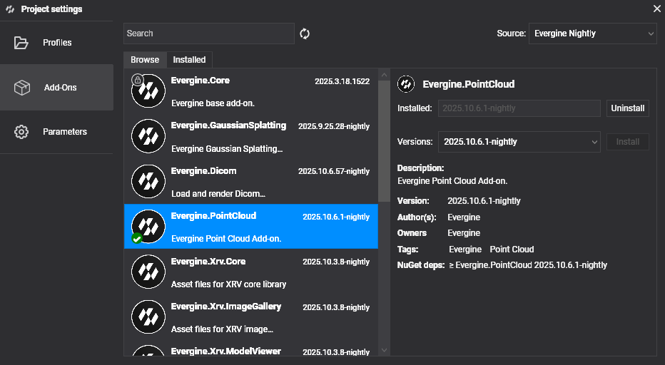

# Getting started with Cesium

---



This page adds Cesium to a project and streams terrain and buildings into a scene. Everything goes through `CesiumCoordinator`, a scene manager that connects to Cesium ion, streams the tilesets you configure, drives the camera, and places your entities on the globe.

## Project setup

### 1. Create a project

Create a project with [Evergine Launcher](../../evergine_launcher/create_project.md) with a **Windows** profile.

> [!NOTE]
> Evergine Cesium does not support Web platforms (WebGL and WebGPU).

### 2. Install the add-on

In Evergine Studio, open the [Add-ons Manager](../index.md#add-ons-manager) and install **Evergine.Cesium**.

> [!NOTE]
> The add-on references NuGet packages. To use nightly builds, add the Evergine nightly feed to your `nuget.config`:
>
> ```xml
> <?xml version="1.0" encoding="utf-8"?>
> <configuration>
>   <packageSources>
>     <add key="nuget.org" value="https://api.nuget.org/v3/index.json" />
>     <add key="Evergine Nightly" value="https://pkgs.dev.azure.com/plainconcepts/Evergine.Nightly/_packaging/Evergine.NightlyBuilds/nuget/v3/index.json" />
>   </packageSources>
> </configuration>
> ```

### 3. Register the CesiumCoordinator

Create the coordinator in your scene's `RegisterManagers`, add the tilesets to stream, and register it. The tilesets must be added before the coordinator starts, because it creates their streams when the scene starts.

```csharp
using Evergine.Cesium;
using Evergine.Cesium.Utils;
using Evergine.Framework;

public class MyScene : Scene
{
    public override void RegisterManagers()
    {
        base.RegisterManagers();

        var cesium = new CesiumCoordinator
        {
            // Read the token from your configuration; do not commit it to source control.
            AccessToken = "<CESIUM_ION_TOKEN>",

            // Optional: enables GeocodeAsync, ReverseGeocodeAsync and AutocompleteAsync.
            GeocodingService = new AzureMapsGeocodingService("<AZURE_MAPS_KEY>"),
        };

        // Cesium World Terrain (asset 1) with Bing aerial imagery.
        // It is also the tileset used to sample the terrain height.
        cesium.AddTileset(1, "Terrain", maxScreenSpaceError: 4,
            overlayProvider: RasterOverlayProvider.BingAerial, preferredForHeightSampling: true);

        // Cesium OSM Buildings (asset 96188), geometry only.
        cesium.AddTileset(96188, "Buildings", maxScreenSpaceError: 1);

        this.Managers.AddManager(cesium);
    }
}
```

When the scene starts, the coordinator checks the internet connection and the token, finds the active camera, adds a `WorldCamera` component to it if it has none, and creates a `CesiumRoot` entity that holds the tiles. It also registers the render feature that draws the tiles, and starts a dedicated worker thread that streams and updates the tilesets.

> [!IMPORTANT]
> The scene must have an active camera with a `Camera3D` component. The token needs the `assets:read` scope.

### Rendering setup

The add-on draws all the tiles with a single GPU-driven pipeline: the geometry of every tile lives in shared vertex and index buffers, the imagery in a shared texture atlas, and the draw calls are generated on the GPU with indirect draws. The materials, effects, and compute shaders it needs are installed with the add-on, so you do not have to create them.

The tiles are rendered by the forward render path, and they are included in the shadow maps of directional lights, so they cast and receive shadows. The add-on sample enables the G-buffer pass and the Z pre-pass of the `ForwardRenderPath`, which is the recommended setup:

```csharp
protected override void CreateScene()
{
    var renderPath = this.Managers.RenderManager.RenderPipeline.DefaultRenderPath as ForwardRenderPath;
    renderPath.GBufferPassIsEnabled = true;
    renderPath.ZPrePassIsEnabled = true;
}
```

> [!NOTE]
> The compute shaders and the C# code of the add-on must come from the same version. When you reference the add-on sources instead of the NuGet package, point the Cesium package `LocalPath` of your `.weproj` to the `Source\Evergine.Cesium.Assets` folder, and rebuild your Windows launchers.

## CesiumCoordinator

Find the coordinator from any component or manager with `this.Managers.FindManager<CesiumCoordinator>()`.

### Configuration and status

| Member | Default | Description |
| --- | --- | --- |
| `AccessToken` | `""` | Cesium ion access token. It can only be set when the coordinator is created. |
| `GeocodingService` | `null` | Service used for geocoding: `AzureMapsGeocodingService`, `GoogleMapsGeocodingService`, or your own `IGeocodingService`. |
| `OverlayProvider` | `RasterOverlayProvider.BingAerial` | Imagery of the tilesets that have an overlay. Changing it reloads their imagery. |
| `UseCPUDrawCalls` | `false` | When `true`, the draw calls are issued from the CPU instead of using GPU indirect draws. |
| `TextureAtlas` | | Read-only. The `Texture` atlas that holds the imagery of the tiles. |
| `CurrentStatus` | `Status.Uninitialized` | Read-only. Connection state: `Ready`, `ReadyWithErrors`, `NoInternetConnection`, `CantReachEndpoint`, `CantAuthenticate`, `MissingTokenPermissions`, and others. |
| `IsInitialized` | `false` | Read-only. `true` when `CurrentStatus` is `Ready` or `ReadyWithErrors`. |
| `IsGeocodingConfigured` | `false` | Read-only. `true` when `GeocodingService` is set. |
| `WorldCamera` | | Read-only. The `WorldCamera` component of the active camera. |
| `Camera` | | Read-only. The `Camera3D` the coordinator drives. |
| `Root` | | Read-only. The `CesiumRoot` entity that contains the tiles. |
| `FetcherNames` | | Read-only. Names of the tilesets that are streaming. |

### Tilesets

| Method | Description |
| --- | --- |
| `AddTileset(int assetId, string name = "Tileset", uint maxScreenSpaceError = 4, RasterOverlayProvider overlayProvider = RasterOverlayProvider.None, bool preferredForHeightSampling = false)` | Adds a Cesium ion tileset. With an `overlayProvider`, the tileset is drawn with that imagery, as terrain usually is; with `RasterOverlayProvider.None`, it is drawn with its own textures, such as 3D buildings. |
| `AddTileset(TilesetConfig config)` | The same, from a `TilesetConfig` record with the same parameters. |
| `RemoveTilesetByName(string name)` | Removes a configured tileset by name. Returns `true` if one was removed. |
| `RemoveTilesetByAssetId(int assetId)` | Removes a configured tileset by Cesium ion asset ID. Returns `true` if one was removed. |

These methods configure the tilesets that the coordinator creates when it initializes, so call them before the scene starts.

| Parameter | Description |
| --- | --- |
| `maxScreenSpaceError` | Maximum screen space error, in pixels, before a tile is refined. Lower values load more detailed tiles at a higher cost. |
| `overlayProvider` | Imagery drawn over the tileset. |
| `preferredForHeightSampling` | Marks the tileset used by `QueryTerrainMinHeight`. If none is marked, the coordinator uses the first tileset with an overlay, and then the first tileset. |

`RasterOverlayProvider` values: `None`, `BingAerial`, `BingAerialWithLabels`, `BingRoads`, `GoogleMapsSatellite`, `GoogleMapsSatelliteWithLabels`, `GoogleMapsRoads`, `GoogleMapsLabelsOnly`, and `GoogleMapsContours`.

> [!NOTE]
> `AddOverlayedTileset` is obsolete. Use `AddTileset` with an `overlayProvider` and `preferredForHeightSampling: true` instead. `AddGeometryTileset` no longer exists: use `AddTileset` without an overlay.

### Camera and terrain

| Method | Description |
| --- | --- |
| `FlyTo(double latitude, double longitude, double seconds)` | Animates the camera to a latitude and longitude, in degrees, over the given time. |
| `QueryTerrainMinHeight(double latitude, double longitude, Action<double?> callback)` | Samples the terrain height at a latitude and longitude, in degrees, and calls the callback with the result, or `null` if it is not available yet. |

`QueryTerrainMinHeight` does not block: the request is processed on the Cesium worker thread together with the tileset updates, and the callback is called later from the scene update, so it is safe to use Evergine objects in it. It needs at least one configured tileset.

`FlyTo` needs the `WorldCamera`, which exists once the coordinator is initialized. For example, from a component:

```csharp
using System;
using Evergine.Cesium;
using Evergine.Framework;

public class FlyToMadrid : Behavior
{
    private bool done;

    protected override void Update(TimeSpan gameTime)
    {
        var cesium = this.Managers.FindManager<CesiumCoordinator>();
        if (!this.done && cesium?.IsInitialized == true)
        {
            cesium.FlyTo(40.4168, -3.7038, 3.0);
            this.done = true;
        }
    }
}
```

### Geocoding

These methods use the configured `GeocodingService`. Without one, they return a result with the `GeocodingStatus.NotConfigured` status.

| Method | Returns |
| --- | --- |
| `GeocodeAsync(string query)` | `GeocodingLookupResult` with the places that match an address or name. `FirstResult` gives the best match. |
| `ReverseGeocodeAsync(double latitude, double longitude)` | `ReverseGeocodingLookupResult` with the address at a position. |
| `AutocompleteAsync(string query, int maxResults = 5)` | `GeocodingAutocompleteResult` with suggestions for a partial query. |

```csharp
var result = await cesium.GeocodeAsync("Eiffel Tower, Paris");
if (result.Status == GeocodingStatus.Success && result.FirstResult is { } place)
{
    cesium.FlyTo(place.Latitude, place.Longitude, 3.0);
}
```

### Diagnostics

| Member | Description |
| --- | --- |
| `Diagnostics` | `CesiumDiagnostics` snapshot of the streaming and GPU memory state. It is empty until the coordinator is initialized. |

`CesiumDiagnostics` contains:

| Member | Description |
| --- | --- |
| `IsInitialized` | `true` when the snapshot has data. |
| `Tilesets` | `TilesetDiagnostics` per tileset, with its `Name` and `VisibleTileCount`. |
| `VisibleTileCount` | Visible tiles of all the tilesets. |
| `ResidentTileCount`, `TileCapacity` | Tiles loaded in the GPU buffers, and the maximum number of tiles they can hold. |
| `VertexBuffer`, `IndexBuffer`, `TextureAtlas` | `GpuBufferDiagnostics` of each shared GPU resource, with its `Name`, `CapacityBytes`, `UsedBytes`, `FreeBytes`, and `UsedRatio`. |
| `GpuCapacityBytes`, `GpuUsedBytes` | Total capacity and usage of the three resources. |

## WorldCamera

`WorldCamera` moves the camera around the globe. With the mouse, drag with the left button to pan, drag with the middle button to tilt (up to 60 degrees from the vertical), and use the wheel to change the height. When the camera is low, it keeps a minimum height above the terrain. The mouse speed does not depend on the frame rate.

| Member | Default | Description |
| --- | --- | --- |
| `latitude` | `40.41` | Latitude of the camera, in degrees. |
| `longitude` | `-3.71` | Longitude of the camera, in degrees. |
| `height` | `1000` | Height of the camera above the ellipsoid, in meters. |
| `Heading`, `Tilt` | `0` | Read-only. Orientation of the camera, in radians. |
| `UIHasFocus` | `false` | Set it to `true` while your UI uses the mouse, so the camera ignores it. |
| `ZoomHeightUpdater` | `null` | Optional callback that replaces the default mouse wheel zoom. |

The camera adjusts its near and far planes to its height, so you do not need to configure them.

### Customize the zoom

By default, the mouse wheel changes the height immediately. To change it, for example to smooth the zoom, assign `ZoomHeightUpdater`. It is called every frame with the current height, the wheel delta, the elapsed time, the minimum height allowed over the terrain, and whether the wheel zoom is enabled, and returns the new height. It is also called while the zoom is disabled, because `UIHasFocus` is `true` or a `FlyTo` is running, so that your controller can cancel any pending movement.

```csharp
// WorldCamera is available once the coordinator is initialized.
var worldCamera = cesium.WorldCamera;
double targetHeight = worldCamera.height;

worldCamera.ZoomHeightUpdater = (height, wheelDelta, elapsed, minHeight, enabled) =>
{
    if (!enabled)
    {
        // A FlyTo or your UI took control: drop the pending zoom.
        targetHeight = height;
        return height;
    }

    // Change the target with the wheel and approach it smoothly.
    targetHeight = Math.Clamp(targetHeight - wheelDelta * targetHeight * 0.1, minHeight, 10_000_000);
    double blend = 1 - Math.Exp(-8 * elapsed.TotalSeconds);
    return height + (targetHeight - height) * blend;
};
```

## Place entities on the globe

Add a `CesiumPlacerComponent` (namespace `Evergine.Cesium.Components`) to an entity to place it at geodetic coordinates. Every frame, the coordinator converts the coordinates to world space and aligns the entity with the local up direction of the globe.

| Field | Default | Description |
| --- | --- | --- |
| `Latitude` | `0` | Latitude, in **radians**. Evergine Studio shows and edits it in degrees. |
| `Longitude` | `0` | Longitude, in **radians**. Evergine Studio shows and edits it in degrees. |
| `Height` | `0` | Height, in meters. |
| `HeightIsRelativeToTerrain` | `false` | When `true`, `Height` is measured from the terrain surface; otherwise, from the WGS84 ellipsoid. |
| `Rotation` | | `Quaternion` applied after aligning the entity with the surface. Set it to `Quaternion.Identity` when you create the component from code. |

```csharp
using System;
using Evergine.Cesium.Components;
using Evergine.Components.Graphics3D;
using Evergine.Framework;
using Evergine.Framework.Graphics;
using Evergine.Mathematics;

const double DegreesToRadians = Math.PI / 180.0;

// A marker 10 m above the ground at the Eiffel Tower.
var marker = new Entity("EiffelTower")
    .AddComponent(new Transform3D())
    .AddComponent(new CesiumPlacerComponent
    {
        Latitude = 48.8584 * DegreesToRadians,
        Longitude = 2.2945 * DegreesToRadians,
        Height = 10.0,
        HeightIsRelativeToTerrain = true,
        Rotation = Quaternion.Identity,
    })
    .AddComponent(new MaterialComponent())
    .AddComponent(new SphereMesh() { Diameter = 5 })
    .AddComponent(new MeshRenderer());

this.Managers.EntityManager.Add(marker);
```

## Light the scene like the sun

Add a `SunLightDirection` component (namespace `Evergine.Cesium.Components`) to the entity of a `DirectionalLight`. It orients the light from the position of the sun for a day of the year, an hour, and a place on the Earth, and it adjusts the color temperature and the intensity of the light to the height of the sun over the horizon: warm and dim at sunrise and sunset, and white and bright at midday.

| Member | Default | Description |
| --- | --- | --- |
| `DayOfYear` | `80` | Day of the year, from `0` to `364`. |
| `HourOfDay` | `17` | Hour of the day in UTC, from `0` to `24`. |
| `TimeScale` | `0` | Simulated hours per real second. With `0`, the sun does not move. |
| `latitude`, `longitude` | `0` | Position of the observer, in degrees. Use them to feed the position of your `WorldCamera`. |
| `LocalHourOfDay` | | Read-only. The solar hour at the longitude of the observer. |
| `SunAltitudeDegrees` | | Read-only. Height of the sun over the horizon, in degrees. It is negative at night. |

```csharp
var sun = this.Owner.FindComponent<SunLightDirection>();
var worldCamera = this.Managers.FindManager<CesiumCoordinator>().WorldCamera;

sun.latitude = worldCamera.latitude;
sun.longitude = worldCamera.longitude;
sun.DayOfYear = 172;   // Around the summer solstice.
sun.HourOfDay = 12;
```

## FAQ

**Can I change the imagery at runtime?**

Yes. Set `CesiumCoordinator.OverlayProvider` to another `RasterOverlayProvider` value. The overlayed tilesets reload their imagery.

**Do I have to manage tile or texture memory?**

No. The add-on loads, caches, and evicts tiles automatically, and it stores them in shared GPU buffers and a texture atlas. You can check how full they are with `CesiumCoordinator.Diagnostics`.

**Does streaming affect my frame rate?**

The tilesets are updated on a dedicated worker thread, so streaming does not block your scene update. The worker runs with a lower priority than the render thread. To tune how many tiles are loaded, lower or raise the `maxScreenSpaceError` of each tileset.

**What happens without a geocoding service?**

The geocoding methods return results with the `NotConfigured` status. Terrain, buildings, imagery, camera navigation, and entity placement work normally.

**The scene loads but there is no terrain. What should I check?**

1. `CesiumCoordinator.CurrentStatus`: it tells you whether the connection or the token failed.
2. That you added at least one tileset with `AddTileset` before the scene started.
3. That your Cesium ion token has the `assets:read` scope and access to those assets.
4. That the scene has an active camera with a `Camera3D` component.
