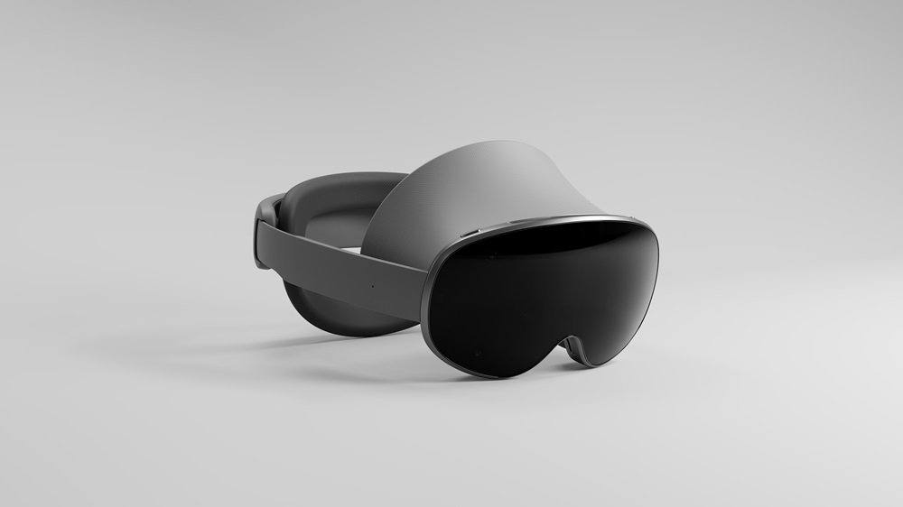
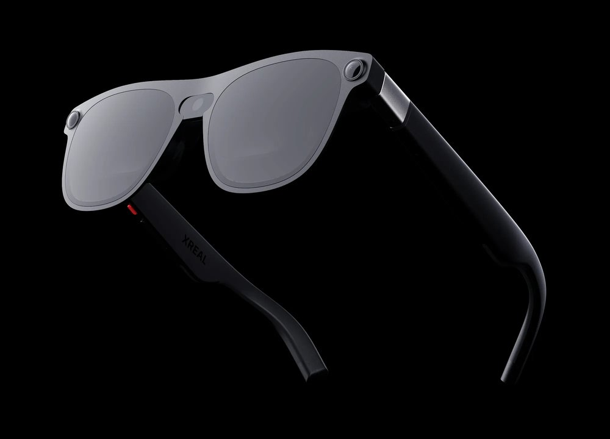
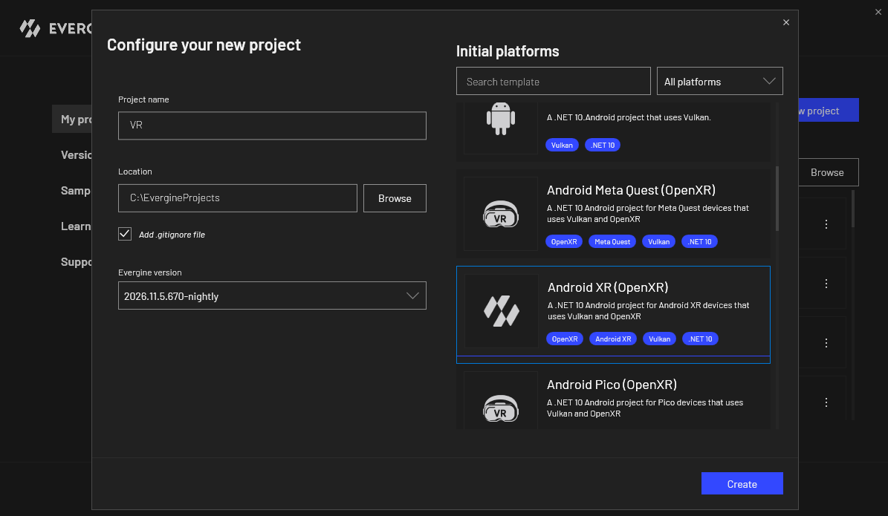
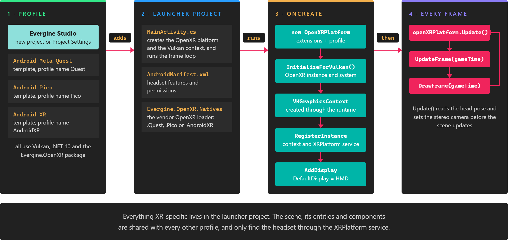
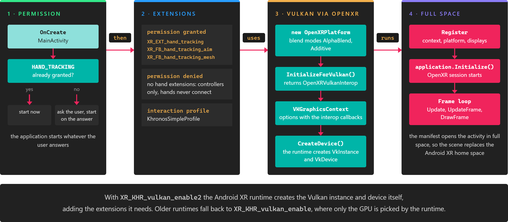
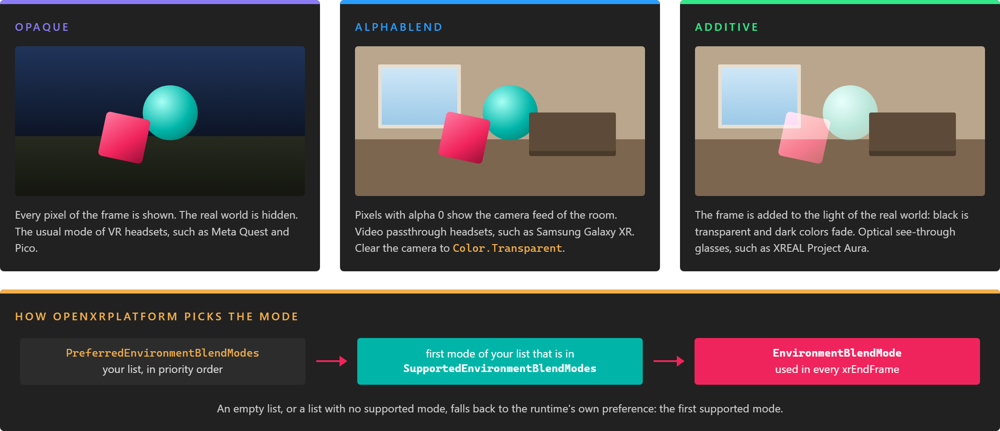

# Android XR


**Android XR** is the version of Android that Google built for headsets and glasses, such as the Samsung Galaxy XR headset and optical see-through glasses like XREAL Aura, announced as Project Aura. Its runtime is an OpenXR runtime, so Evergine targets it through [OpenXR](openxr_platform.md) with Vulkan, in the same way as [Meta Quest](metaquest.md) and [Pico](pico.md).

Two things set it apart from the other Android headsets. Hands are the main input, so the template asks for the hand tracking permission before it starts. And many Android XR devices show the real world around the user, so the template asks the runtime for a [blend mode](#mixed-reality-with-environment-blend-modes) that lets the room show through the scene.

## Devices

Android XR runs on two kinds of devices, and the same application works on both. Each one shows the real world in its own way, so the template asks for both [blend modes](#mixed-reality-with-environment-blend-modes) and lets the runtime choose.

| Device | Kind | How the real world is shown |
| --- | --- | --- |
| Samsung Galaxy XR | Headset with video passthrough | The cameras capture the room and the compositor draws the scene over it (`AlphaBlend`). |
| XREAL Aura (Project Aura) | Optical see-through glasses, wired to a compute puck | The user sees the room through the lenses and the scene is added to its light (`Additive`). |



*Samsung Galaxy XR, shown here with its Project Moohan prototype name. Image by SsSeanChoi, [CC BY-SA 4.0](https://creativecommons.org/licenses/by-sa/4.0/), via [Wikimedia Commons](https://commons.wikimedia.org/wiki/File:Samsung-Mobile-XR-Project-Moohan-Android-XR-platform-Google_main1.jpg).*



*XREAL Aura, the first wired XR glasses with Android XR. Image by [XREAL](https://www.xreal.com/aura).*

## Requirements

* A device that runs Android XR. The launcher project targets Android 14 (API level 34) or later.
* The .NET 10 SDK with the Android workload, as for any [Android](../../platforms/android/index.md) profile.
* Developer options and USB debugging enabled on the device.

## Create an Android XR project

Select the **Android XR (OpenXR)** template when you create a project:



To add Android XR to an existing project, open **Project Settings**, add a profile and choose the same template. The profile is named **AndroidXR** by default, and its launcher project is `<YourProject>.AndroidXR`.



*The profile adds a launcher project. Everything that is specific to the device is in it, and the scene is shared with the other profiles.*

## What the template contains

| File | Purpose |
| --- | --- |
| `MainActivity.cs` | Asks for the hand tracking permission, creates `OpenXRPlatform`, lets OpenXR create the Vulkan graphics context, and runs the frame loop. |
| `AndroidManifest.xml` | Requires an OpenXR runtime, declares hand tracking as optional, asks for the hand tracking and OpenXR permissions, and starts the activity in full space. |
| `*.csproj` | References `Evergine.OpenXR`, `Evergine.Vulkan`, `Evergine.OpenAL` and `Evergine.OpenXR.Natives.AndroidXR`, the OpenXR loader for Android XR. |
| `linker.xml` | Keeps the Evergine types that are only reached through reflection when the application is trimmed. |
| `Resources` | The application icons and the splash screen shown while the application starts. |

This is what happens when the application starts:



### The hand tracking permission

On Android XR, hand tracking data is protected by the `android.permission.HAND_TRACKING` runtime permission. `OnCreate` checks it first. If the user already granted it, the application starts at once. Otherwise the system asks the user, and the application starts when the answer arrives, whatever the answer is.

The OpenXR extensions are then chosen from that answer:

```csharp
var requestedOpenXRExtensions = new List<string>();
if (this.CheckSelfPermission(HandTrackingPermission) == Permission.Granted)
{
    requestedOpenXRExtensions.Add("XR_EXT_hand_tracking"); // Enable hand tracking in OpenXR application
    requestedOpenXRExtensions.Add("XR_FB_hand_tracking_aim"); // System aim ray and pinch strength for each hand
    requestedOpenXRExtensions.Add("XR_FB_hand_tracking_mesh"); // Skinned hand mesh driven by the hand joints
}
```

With the permission, hands work as they do on Meta Quest: [`TrackXRArticulatedHand`](../input_tracking/trackxrarticulatedhand.md) receives the joints, a pinch reports as the hand's trigger, and `XRDeviceRenderableModel` can draw the hand mesh. Without it, the application still runs, the hands never connect, and only controllers are tracked.

> [!NOTE]
> The user can change the permission later in the system settings. The extensions are chosen when the application starts, so a change takes effect the next time the application starts.

### The OpenXR platform

The template creates the platform with the Khronos simple controller profile, which every OpenXR runtime supports, and with a list of preferred [environment blend modes](#mixed-reality-with-environment-blend-modes):

```csharp
this.openXRPlatform = new OpenXRPlatform(
    requestedOpenXRExtensions.ToArray(),
    new OpenXRInteractionProfile[]
    {
        DefaultInteractionProfiles.KhronosSimpleProfile,
    })
{
    ApplicationName = "$safeprojectname$",
    RenderMirrorTexture = false,
    ReferenceSpace = ReferenceSpaceType.Stage,
    MirrorDisplay = mirrorDisplay,
    // For AR, uncomment to prefer the first supported mode below; otherwise the runtime preference is used.
    // Opaque mode may dim optical see-through lenses (e.g. XREAL Aura).
    PreferredEnvironmentBlendModes = new[] { EnvironmentBlendMode.AlphaBlend, EnvironmentBlendMode.Additive },
};
```

`ApplicationName` is replaced with the name of your project when the profile is created. The simple controller profile only has a select button and a menu button, so add other [interaction profiles](openxr_platform.md#interaction-profiles) to the array if your users have controllers with more inputs.

### Vulkan created through OpenXR

Android XR creates the Vulkan instance and device itself, through the `XR_KHR_vulkan_enable2` extension, so the template initializes OpenXR **before** it creates the graphics context. [`InitializeForVulkan`](openxr_platform.md#vulkan-graphics-context) creates the OpenXR instance and system and returns the callbacks that the `VKGraphicsContext` uses to create its Vulkan objects:

```csharp
// OpenXR is initialized first: the runtime takes part in the creation of the Vulkan instance and device
var openXRVulkan = this.openXRPlatform.InitializeForVulkan();

// Enable Vulkan extensions required by Android XR and OpenXR
var graphicsContext = new global::Evergine.Vulkan.VKGraphicsContext(new global::Evergine.Vulkan.VKGraphicsContextOptions()
{
    DeviceExtensions = new[]
    {
        "VK_KHR_multiview",
        "VK_ANDROID_external_memory_android_hardware_buffer",
        "VK_KHR_bind_memory2",
        "VK_KHR_dedicated_allocation",
        "VK_KHR_external_memory",
        "VK_KHR_external_memory_fd",
        "VK_KHR_get_memory_requirements2",
        "VK_KHR_sampler_ycbcr_conversion",
    }.Union(openXRVulkan.DeviceExtensions),
    InstanceExtensions = new[]
    {
        "VK_KHR_get_physical_device_properties2",
        "VK_KHR_external_memory_capabilities",
    }.Union(openXRVulkan.InstanceExtensions),
    CreateInstance = openXRVulkan.CreateInstance,
    SelectPhysicalDevice = openXRVulkan.SelectPhysicalDevice,
    CreateDevice = openXRVulkan.CreateDevice,
});

graphicsContext.CreateDevice();
application.Container.RegisterInstance<GraphicsContext>(graphicsContext);
application.Container.RegisterInstance(this.openXRPlatform);
```

Compared with Meta Quest, the device extension list adds the Android hardware buffer extensions that the Android XR compositor uses to share its swapchain images with Vulkan.

### The manifest

| Entry | Why it is there |
| --- | --- |
| `android.software.xr.api.openxr` (required) | Only devices with an OpenXR runtime can install the application. |
| `android.hardware.xr.input.hand_tracking` (not required) | Hand tracking is used when available, but devices without it can still install the application. |
| `android.permission.HAND_TRACKING` | The permission asked for at startup. |
| `org.khronos.openxr.permission.OPENXR_SYSTEM` and the `queries` block | Let the OpenXR loader find the runtime and its API layers on the device. |
| `libopenxr.google.so` (native library, not required) | The Android XR OpenXR runtime library. |
| `android.window.PROPERTY_XR_ACTIVITY_START_MODE` set to `XR_ACTIVITY_START_MODE_FULL_SPACE_UNMANAGED` | The activity opens in **full space**: the scene takes the whole view instead of a panel in the Android XR home space, and the application renders it with OpenXR. |

## Mixed reality with environment blend modes

The environment blend mode tells the compositor how to mix each frame with the real world. On Android XR, this is how a scene shows the room: there is no passthrough layer as on Meta Quest, so `XRPlatform.Passthrough` is `null` and `XRPassthroughLayerComponent` does nothing.



The template prefers `AlphaBlend` and then `Additive`. `OpenXRPlatform` uses the first one that the device supports, and the runtime's own preference when it supports neither:

* On a video passthrough headset, `AlphaBlend` shows the camera feed wherever the scene is transparent. To see the room, clear the camera to `Color.Transparent` and remove the sky or any background entity. Otherwise the scene covers the room, as in VR.
* On optical see-through glasses such as XREAL Aura, `Additive` adds the scene to the light that reaches the eye. Black is transparent, so keep the background black and use bright colors for the content.

For a VR application that always hides the room, remove the `PreferredEnvironmentBlendModes` line, or put `EnvironmentBlendMode.Opaque` first in the array.

Check what the device offers in `SupportedEnvironmentBlendModes`, and what the platform chose in `EnvironmentBlendMode`. Both are filled once the platform starts. [OpenXR Platform](openxr_platform.md#environment-blend-modes) describes the three properties.

## Run on the device

1. Enable developer options and USB debugging in the settings of the device.
2. Connect the device to the PC with a USB cable and allow USB debugging when the device asks.
3. Open the solution of the AndroidXR profile in Visual Studio, select the device as the target, and start debugging.
4. Allow hand tracking when the application asks for it on its first start.

## Compared with Meta Quest and Pico

| | Android XR | Android Meta Quest | Android Pico |
| --- | --- | --- | --- |
| OpenXR loader package | `Evergine.OpenXR.Natives.AndroidXR` | `Evergine.OpenXR.Natives.Quest` | `Evergine.OpenXR.Natives.Pico` |
| Interaction profile | `KhronosSimpleProfile` | `OculusTouchProfile` | `PicoNeo3Profile` |
| Hand extensions | Requested only when the hand tracking permission is granted | Always requested | `XR_EXT_hand_tracking` only |
| Real world view | Environment blend mode (`AlphaBlend` or `Additive`) | [Passthrough](../passthrough.md) layers (`XR_FB_passthrough`) | None |
| Manifest | OpenXR runtime required, full space start mode | Meta VR intent category | `pvr.app.type` set to `vr` |
| Minimum Android version | Android 14 (API level 34) | Android 6.0 (API level 23) | Android 6.0 (API level 23) |

All three create the Vulkan graphics context through `InitializeForVulkan`, render with multiview, and share the same scene.

## See also

* [OpenXR Platform](openxr_platform.md): every `OpenXRPlatform` property, the Vulkan graphics context, blend modes and interaction profiles.
* [Input Devices](../input_tracking/index.md): tracking controllers and hands in the scene.
* [Android XR developer documentation](https://developer.android.com/develop/xr/openxr): the OpenXR extensions Android XR supports.
