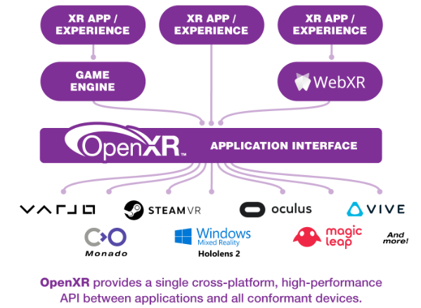
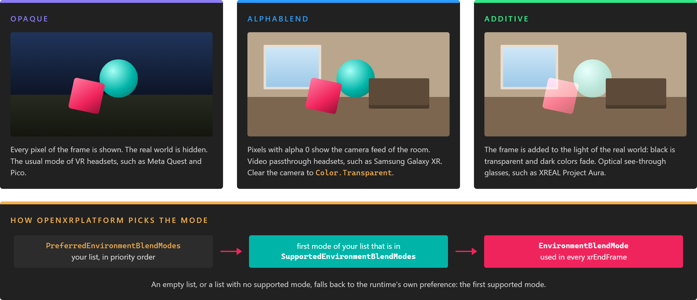

# OpenXR Platform



`OpenXRPlatform` is the [`XRPlatform`](../xrplatform.md) implementation for OpenXR, in the **Evergine.OpenXR** package. It creates the OpenXR instance and session, renders the scene into the runtime's swapchains, and turns the runtime's actions and extensions into Evergine devices, hand joints and passthrough layers.

Every OpenXR template creates one in its launcher project. You change its configuration there: which extensions to request, which controllers to support, and how the tracking space is anchored.

## Creating the platform

`OpenXRPlatform` has two constructors:

| Constructor | Description |
| --- | --- |
| `OpenXRPlatform()` | No optional extensions. Controllers use the Khronos simple controller profile. |
| `OpenXRPlatform(string[] extensionsToEnable, OpenXRInteractionProfile[] interactionProfiles = null)` | Requests the given [extensions](#extensions) and registers the given [interaction profiles](#interaction-profiles). A `null` profile list falls back to `DefaultInteractionProfiles.KhronosSimpleProfile`. |

On Vulkan, call [`InitializeForVulkan`](#vulkan-graphics-context) after the constructor and before you create the graphics context. This is how the **Android Meta Quest (OpenXR)** template does it, in `MainActivity.cs`:

```csharp
// Create mirror display...
FrameBuffer frameBuffer = null!;
var mirrorDisplay = new Display(surface, frameBuffer);

// Create OpenXR Platform
openXRPlatform = new OpenXRPlatform(
    new string[]
    {
            "XR_EXT_hand_tracking",         // Enable hand tracking in OpenXR application
            "XR_FB_hand_tracking_aim",      // Allow to use hand gestures in Meta Quest devices
            "XR_FB_hand_tracking_mesh",     // Obtain hand mesh in Meta Quest devices

        // "XR_FB_passthrough",         // Enable Passthrough in Meta Quest devices
        // "XR_FB_triangle_mesh",       // Allow to project Passthrough on Meshes

        // "XR_META_simultaneous_hands_and_controllers", // Allow to use hands and controllers simultaneously
    },
    new OpenXRInteractionProfile[]
    {
            DefaultInteractionProfiles.OculusTouchProfile
    })
{
    // UseSimultaneousHandsAndControllers = true, // Enable using simultaneously the hands and controllers
    RenderMirrorTexture = false,
    ReferenceSpace = ReferenceSpaceType.Stage,
    MirrorDisplay = mirrorDisplay,
};

// OpenXR is initialized first: the runtime takes part in the creation of the Vulkan instance and device
var openXRVulkan = openXRPlatform.InitializeForVulkan();

// Enable Vulkan extensions required by Oculus & OpenXR
var graphicsContext = new global::Evergine.Vulkan.VKGraphicsContext(new global::Evergine.Vulkan.VKGraphicsContextOptions()
{
    DeviceExtensions = new[]
    {
            "VK_KHR_multiview",
            "VK_KHR_external_memory",
            "VK_KHR_external_memory_fd",
            "VK_KHR_get_memory_requirements2",
    }.Union(openXRVulkan.DeviceExtensions),
    InstanceExtensions = new[]
    {
            "VK_KHR_get_physical_device_properties2",
            "VK_KHR_external_memory_capabilities",
    }.Union(openXRVulkan.InstanceExtensions),
    CreateInstance = openXRVulkan.CreateInstance,
    SelectPhysicalDevice = openXRVulkan.SelectPhysicalDevice,
    CreateDevice = openXRVulkan.CreateDevice,
});

graphicsContext.CreateDevice();
application.Container.RegisterInstance<GraphicsContext>(graphicsContext);
application.Container.RegisterInstance(openXRPlatform);

// Register the displays...
var graphicsPresenter = application.Container.Resolve<GraphicsPresenter>();
graphicsPresenter.AddDisplay("DefaultDisplay", openXRPlatform.Display);
graphicsPresenter.AddDisplay("MirrorDisplay", mirrorDisplay);
```

The [Pico](pico.md) and [Android XR](androidxr.md) templates differ in the extension list, the interaction profiles and the Vulkan device extensions. The [Windows](windows.md) template uses DirectX 11, so it creates and registers its graphics context before the platform and does not call `InitializeForVulkan`. [XR Platform](../xrplatform.md#creating-and-registering-a-platform) explains the four steps every launcher follows.

> [!IMPORTANT]
> Set every property in the object initializer. The platform reads the extension list, `ApplicationName` and `FormFactor` when it creates the OpenXR instance and system, and `ViewConfiguration`, `ReferenceSpace` and `OverSampling` when it creates the session. On Vulkan the instance and system are created in `InitializeForVulkan`, on the other backends during `application.Initialize()`, and the session is always created during `application.Initialize()`. Changing them afterwards has no effect.

## Properties

| Property | Default | Description |
| --- | --- | --- |
| **ReferenceSpace** | `Stage` | The origin of the tracking space. See [Reference spaces](#reference-spaces). |
| **FormFactor** | `HeadMountedDisplay` | The kind of device to request from the runtime: `HeadMountedDisplay` or `HandheldDisplay`. If no device of that kind is found, the platform logs it and asks again every second. |
| **ViewConfiguration** | `PrimaryStereo` | `PrimaryStereo` renders one view per eye. `PrimaryMono` renders a single view, for handheld displays. |
| **OverSampling** | 1.0 | Multiplier of the resolution the runtime recommends for the swapchain. Values above 1 sharpen the image at a GPU cost, and the result is clamped to the runtime's maximum. |
| **ApplicationName** | `"Evergine.OpenXR"` | The name sent to the runtime when the instance is created. Some runtimes show it in their dashboards. |
| **UseSimultaneousHandsAndControllers** | `false` | Tracks hands and controllers at the same time, so a hand can be tracked while the other holds a controller. Needs `XR_META_simultaneous_hands_and_controllers`. Unlike the other properties, you can change it while the application runs. |
| **PreferredEnvironmentBlendModes** | Empty | The [environment blend modes](#environment-blend-modes) you want, in priority order. The first one the runtime supports is used. You can change it while the application runs. |
| **SupportedEnvironmentBlendModes** | Empty until the system exists | The blend modes the runtime supports, the runtime's preferred one first. Read-only. |
| **EnvironmentBlendMode** | The runtime's preferred mode | The blend mode used to submit frames. Read-only. |
| **ExtensionsToEnable** | The constructor argument | The extensions requested at startup. Read-only. |
| **GraphicBackend** | Created on attach | The OpenXR integration of the graphics backend: DirectX 11, Vulkan or OpenGL. Any other backend throws `InvalidOperationException` when the platform attaches. |

`OpenXRPlatform` also inherits the [`XRPlatform` properties](../xrplatform.md#properties): `MirrorDisplay`, `RenderMirrorTexture`, `MSAASampleCount`, `NearClipDistance`, `FarClipDistance`, and the `InputTracking`, `RenderableModels` and `Passthrough` subsystems.

### Reference spaces

The reference space decides where the origin of the tracking space is, and so where the parent of your camera sits in the real world.

| Value | Origin | Use it for |
| --- | --- | --- |
| **Stage** (default) | On the floor, at the centre of the play area the user set up | Standing and room-scale experiences. The height of the camera above its parent is the user's real eye height. |
| **Local** | At the head position when the application started, facing forward | Seated experiences. Content does not depend on the floor. |
| **View** | At the head, moving with it | Head-locked content only. Rarely what you want for a whole scene. |
| **Unbounded** | World-locked, with no play area limit | Large spaces where the user walks far from the start point. Requires the `XR_MSFT_unbounded_reference_space` extension in the constructor list. |

```csharp
// In the launcher: a seated experience, rendered 20% above the recommended resolution.
openXRPlatform = new OpenXRPlatform(
    new[] { "XR_EXT_hand_tracking" },
    new[] { DefaultInteractionProfiles.OculusTouchProfile })
{
    ReferenceSpace = ReferenceSpaceType.Local,
    OverSampling = 1.2f,
    MirrorDisplay = mirrorDisplay,
};
```

## Vulkan graphics context

Some OpenXR runtimes, such as Android XR, have to take part in the creation of the Vulkan instance and device: they add the Vulkan extensions they need and choose the GPU. `OpenXRPlatform.InitializeForVulkan()` makes this possible. It creates the OpenXR instance and system before the graphics context exists, and returns an `OpenXRVulkanInterop` with what the `VKGraphicsContext` needs:

| Member | Description |
| --- | --- |
| `InstanceExtensions`, `DeviceExtensions` | The Vulkan extensions the runtime requires. Add them to your own lists with `Union`. They are empty with `XR_KHR_vulkan_enable2`, where the runtime adds its extensions itself. |
| `CreateInstance`, `SelectPhysicalDevice`, `CreateDevice` | Methods with the signatures of the `VKGraphicsContextOptions` callbacks. Assign them directly. |
| `UsesVulkanEnable2` | `true` when the runtime creates the Vulkan objects (`XR_KHR_vulkan_enable2`). `false` when Evergine creates them and the runtime only picks the GPU (`XR_KHR_vulkan_enable`). |

The order is always the same, and every Vulkan template follows it:

1. Create `OpenXRPlatform` and set its properties.
2. Call `InitializeForVulkan()`.
3. Create the `VKGraphicsContext` with a `VKGraphicsContextOptions` that uses the interop extensions and methods, and call `CreateDevice()`.
4. Register the graphics context and the platform, and add the displays.

`OpenXRPlatform` prefers `XR_KHR_vulkan_enable2` and falls back to `XR_KHR_vulkan_enable` on older runtimes. When the session starts, it also checks that the Vulkan version of the graphics context is one the runtime accepts.

> [!IMPORTANT]
> A Vulkan graphics context created without these callbacks only works on runtimes that support `XR_KHR_vulkan_enable`. On a runtime that only supports `XR_KHR_vulkan_enable2` the platform throws `InvalidOperationException` and asks you to call `InitializeForVulkan()`. Calling `InitializeForVulkan()` and then creating the graphics context without the callbacks also throws. Projects created from a Meta Quest or Pico template of an earlier release create the graphics context first. They keep working on runtimes that support `XR_KHR_vulkan_enable`; update their `MainActivity.cs` to the order above to run them on any runtime.

## Environment blend modes

The environment blend mode tells the compositor how to mix the frames of the application with the real world:

| Mode | Result | Typical devices |
| --- | --- | --- |
| `Opaque` | The frame covers the whole view. | VR headsets. Some optical see-through devices dim their lenses in this mode. |
| `AlphaBlend` | Pixels with alpha 0 show the real world, through the device cameras. | Video passthrough headsets, such as Samsung Galaxy XR. |
| `Additive` | The frame is added to the light of the real world, so black is transparent. | Optical see-through glasses. |



`PreferredEnvironmentBlendModes` is the list of modes you want, in priority order. When the system is created, `SupportedEnvironmentBlendModes` is filled with the modes of the runtime, and `EnvironmentBlendMode` is set to the first preferred mode the runtime supports, or to the runtime's own preference when there is none. The platform logs the supported and selected modes, and a warning when none of your modes is supported.

```csharp
openXRPlatform = new OpenXRPlatform(extensions, profiles)
{
    // Show the room where the scene is transparent, or add the scene to it on optical see-through glasses.
    PreferredEnvironmentBlendModes = new[] { EnvironmentBlendMode.AlphaBlend, EnvironmentBlendMode.Additive },
    MirrorDisplay = mirrorDisplay,
};
```

With `AlphaBlend`, the room only shows where the scene is transparent: clear the camera to `Color.Transparent` and remove any sky or background entity. The [Android XR](androidxr.md) template uses this mechanism to show the real world. On Meta Quest, use [passthrough](../passthrough.md) layers instead.

## Extensions

OpenXR features beyond the core are **extensions**. `OpenXRPlatform` enables some by itself and the rest only when you pass their names to the constructor.

Always enabled when the runtime supports them:

* The extension of the graphics backend: `XR_KHR_D3D11_enable`, `XR_KHR_opengl_enable`, or for Vulkan `XR_KHR_vulkan_enable2` when you use `InitializeForVulkan` and the runtime supports it, and `XR_KHR_vulkan_enable` otherwise.
* `XR_KHR_composition_layer_depth`, which lets the runtime use the depth buffer to reproject frames.

Extensions that Evergine uses when you request them:

| Extension | What it enables in Evergine |
| --- | --- |
| `XR_EXT_hand_tracking` | Articulated hand devices for [`TrackXRArticulatedHand`](../input_tracking/trackxrarticulatedhand.md). |
| `XR_FB_hand_tracking_aim` | A pinch reports as the hand's `Trigger` and `TriggerButton`, and the hand gets an aim `Pointer`. Meta Quest, Android XR. |
| `XR_FB_hand_tracking_mesh` | A skinned hand model for [`XRDeviceRenderableModel`](../input_tracking/trackxrarticulatedhand.md#render-the-hands). Meta Quest, Android XR. |
| `XR_FB_passthrough` | The [passthrough](../passthrough.md) subsystem. Meta Quest. |
| `XR_FB_triangle_mesh` | Passthrough projected on your own meshes (`XRPassthroughSurfaceMeshComponent`). Meta Quest. |
| `XR_META_simultaneous_hands_and_controllers` | The `UseSimultaneousHandsAndControllers` property. Meta Quest. |
| `XR_MSFT_unbounded_reference_space` | The `Unbounded` reference space. |

An extension the runtime does not support is skipped: the platform reports a warning through the graphics context's validation layer, when one is enabled, and starts without it. The feature it drives then stays unavailable, for example `Passthrough` stays `null`.

> [!NOTE]
> Some extensions also need permissions or features in the Android manifest. See [Meta Quest](metaquest.md#optional-features) for passthrough, and [Android XR](androidxr.md#the-hand-tracking-permission) for the hand tracking permission.

## Interaction profiles

An **interaction profile** tells the runtime which physical controller you expect and how its inputs map to Evergine's actions. The runtime picks the profile that matches the controller in the user's hands. If none of the profiles you registered matches, the controller never connects, and `TrackXRController.IsConnected` stays `false`.

`DefaultInteractionProfiles` provides profiles for the common controllers:

| Profile | Interaction path | Used by |
| --- | --- | --- |
| `KhronosSimpleProfile` | `/interaction_profiles/khr/simple_controller` | The default when you pass no profiles, and the Android XR template. Select and menu buttons only. |
| `OculusTouchProfile` | `/interaction_profiles/oculus/touch_controller` | Meta Quest template, Windows template |
| `PicoNeo3Profile` | `/interaction_profiles/pico/neo3_controller` | Pico template |
| `HTCViveControllerProfile` | `/interaction_profiles/htc/vive_controller` | Windows template |
| `ValveIndexControllerProfile` | `/interaction_profiles/valve/index_controller` | Windows template |
| `MixedRealityMotionControllerProfile` | `/interaction_profiles/microsoft/motion_controller` | Windows template |
| `OculusGoProfile` | `/interaction_profiles/oculus/go_controller` | Windows template |

Each profile maps Evergine action names to OpenXR input paths in its `SupportedComponents` dictionary. These are the actions and the part of the controller state they fill:

| Action | Fills |
| --- | --- |
| `pose` | The device pose that moves the entity. |
| `aimpose` | `Pointer`. |
| `trigger` | `ControllerState.Trigger` (0 to 1). |
| `triggerclick` | `ControllerState.TriggerButton`. |
| `gripclick` | `ControllerState.Grip`. |
| `thumbstickx`, `thumbsticky` | `ControllerState.ThumbStick`. |
| `thumbstickclick` | `ControllerState.ThumbStickButton`. |
| `menu` | `ControllerState.Menu`. |
| `button1`, `button2` | `ControllerState.Button1` and `ControllerState.Button2`. |

To support a controller that has no default profile, or to map its inputs differently, create an `OpenXRInteractionProfile` with its interaction path, the user paths it applies to, and the input path for each action, then pass it to the constructor with the others. A path that starts with `/input` applies to every user path. A full path such as `/user/hand/left/input/x/click` applies to that hand only, and several paths are separated by spaces.

```csharp
using System.Collections.Generic;
using Evergine.OpenXR;

// The simple controller has no trigger: report its select button as the trigger button.
var simpleProfile = new OpenXRInteractionProfile()
{
    InteractionPath = "/interaction_profiles/khr/simple_controller",
    UserPaths = new List<string>() { "/user/hand/left", "/user/hand/right" },
    SupportedComponents = new Dictionary<string, string>()
    {
        { "triggerclick", "/input/select/click" },
        { "menu", "/input/menu/click" },
        { "pose", "/input/grip/pose" },
        { "aimpose", "/input/aim/pose" },
    },
};
```

## In this section

* [Meta Quest](metaquest.md)
* [Pico](pico.md)
* [Android XR](androidxr.md)
* [Windows (PC VR)](windows.md)
